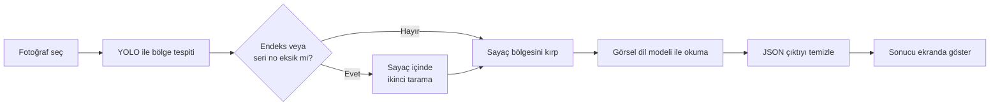

# SmartWaterMeter: Akıllı Su Sayacı Okuma Sistemi


Bir su sayacı fotoğrafından **endeks (tüketim) değerini** ve **seri numarasını** otomatik olarak bulup okuyan masaüstü uygulaması. Sistem, nesne tespiti (YOLOv8) ile görsel dil modelini (Qwen2.5-VL) birlikte kullanır. Tamamen yerel çalışır: internet bağlantısı gerektirmez, bulut servisi kullanmaz ve ek bir maliyeti yoktur.

> Bu proje, KASKİ (Kayseri Su ve Kanalizasyon İdaresi) Bilgi İşlem biriminde yapılan yazılım stajı kapsamında geliştirilmiştir.

## İçindekiler

- [Özellikler](#özellikler)
- [Nasıl Çalışır](#nasıl-çalışır)
- [Kullanılan Teknolojiler](#kullanılan-teknolojiler)
- [Klasör Yapısı](#klasör-yapısı)
- [Kurulum](#kurulum)
- [Kullanım](#kullanım)
- [Yapılandırma](#yapılandırma)
- [Model ve Veri Seti](#model-ve-veri-seti)
- [Sorun Giderme](#sorun-giderme)
- [Bilinen Sınırlamalar](#bilinen-sınırlamalar)
- [Geliştirilebilecekler](#geliştirilebilecekler)

## Özellikler

- Fotoğraftaki **sayaç gövdesini, endeks penceresini ve seri numarası bölgesini** otomatik tespit eder.
- Bir bölge ilk taramada bulunamazsa, **sayaç içinde ikinci bir tarama** yapar.
- Rakamları, sayacın yapısını anlatan özel talimatlarla yönlendirilen bir **görsel dil modeliyle** okur. Böylece endeks penceresindeki kırmızı rakamlar ve ibreler sonuca karışmaz.
- Modelin cevabını JSON olarak alır ve **yalnızca rakamlardan oluşan temiz sonuç** üretir.
- Tespit edilen bölgeleri fotoğraf üzerinde **güven değerleriyle birlikte** gösterir.
- Hata durumlarında (model yok, Ollama kapalı, görsel okunamıyor) uygulama kapanmaz, kullanıcıya durum bildirir.
- Tamamen **çevrimdışı** çalışır, fotoğraflar bilgisayardan dışarı çıkmaz.

## Nasıl Çalışır

Sistem iki aşamalı bir yapıya sahiptir: önce **nerede**, sonra **ne yazıyor**.



**1. Aşama: Bölge tespiti (YOLO)**
Eğitilmiş YOLOv8 modeli (`models/best.pt`) fotoğrafta üç sınıfı arar: `su_sayaci` (sayacın tamamı), `endeks` (mekanik tüketim penceresi) ve `seri_no` (sayaç üzerindeki seri numarası bölgesi). Sayaç bulunmuş ama endeks ya da seri numarası bulunamamışsa, sayaç bölgesi kırpılır ve model bu küçük görüntüde daha düşük bir güven eşiğiyle yeniden çalıştırılır. Bulunan koordinatlar tekrar orijinal fotoğraftaki konumlarına çevrilir.

**2. Aşama: Okuma (görsel dil modeli)**
En yüksek güvenli sayaç bölgesi, etrafında küçük bir pay bırakılarak kırpılır ve yerelde çalışan `qwen2.5vl:7b` modeline gönderilir. Modele endeksin ve seri numarasının sayaç üzerinde nasıl göründüğü anlatılır, cevabı JSON olarak vermesi istenir. Gelen cevap işlenip yalnızca rakamlar arayüze yazılır.

Klasik OCR yöntemleri bu sayaçlarda yansıma, eğik çekim, kabartma seri numarası ve kırmızı rakamlar nedeniyle yetersiz kaldığı için okuma için görsel dil modeli tercih edilmiştir.

## Kullanılan Teknolojiler

| Alan | Teknoloji |
|---|---|
| Programlama dili | Python |
| Nesne tespiti | Ultralytics YOLOv8 (`yolov8n`) |
| Veri etiketleme | Roboflow |
| Görüntü işleme | OpenCV, NumPy, Pillow |
| Okuma modeli | Qwen2.5-VL 7B (Ollama üzerinden) |
| Arayüz | CustomTkinter |

## Klasör Yapısı

```
SmartWaterMeter/
├── core/
│   ├── detector.py      # WaterMeterDetector: YOLO ile bölge tespiti, ikinci tarama
│   ├── processor.py     # ImageProcessor: bölge kırpma (padding ve sınır kontrolüyle)
│   └── ocr_engine.py    # OCREngine: Ollama ile okuma, talimat, JSON ayrıştırma
├── ui/
│   └── app_gui.py       # AppGUI: masaüstü arayüzü ve işlem akışı
├── models/
│   └── best.pt          # Eğitilmiş YOLO modeli
├── main.py              # Uygulama giriş noktası
├── requirements.txt     # Python bağımlılıkları
└── README.md
```

Her sınıf tek bir işten sorumludur. `AppGUI` diğer üç sınıfı kullanır, onların iç işleyişini bilmez.

## Kurulum

### Gereksinimler

- Python 3.10 veya üzeri
- [Ollama](https://ollama.com)
- Yaklaşık 6 GB boş disk alanı (görsel dil modeli için)
- Ekran kartı önerilir. Yalnızca işlemciyle de çalışır ama okuma daha uzun sürer.

### Adımlar

1. Depoyu klonlayın:
```bash
   git clone https://github.com/m-alomarr/SmartWaterMeter.git
   cd SmartWaterMeter
```

2. Sanal ortam oluşturup etkinleştirin:
```bash
   python -m venv .venv
   .venv\Scripts\activate        # Windows
   source .venv/bin/activate     # macOS / Linux
```

3. Bağımlılıkları yükleyin:
```bash
   pip install -r requirements.txt
```

4. Ollama'yı kurun ve görsel dil modelini indirin (internet yalnızca bu adımda gerekir):
```bash
   ollama pull qwen2.5vl:7b
```

5. Modelin indiğini kontrol edin:
```bash
   ollama list
```

## Kullanım

Ollama'nın çalıştığından emin olduktan sonra uygulamayı başlatın:

```bash
python main.py
```

1. **"Fotoğraf Seç ve Analiz Et"** butonuna tıklayın.
2. Bir su sayacı fotoğrafı seçin (JPG, JPEG veya PNG).
3. Program fotoğraf üzerinde tespit ettiği bölgeleri yeşil kutularla ve güven değerleriyle gösterir.
4. Sağ panelde **endeks** ve **seri numarası** değerleri görünür. Bir değer okunamazsa ilgili kutuda "Okunamadı" yazar.

Durum satırı işlemin aşamasını gösterir: `Hazır`, `Analiz ediliyor`, `Tamamlandı` veya `Hata oluştu`.

## Yapılandırma

Aşağıdaki değerler ilgili dosyalardan değiştirilebilir:

| Ayar | Varsayılan | Konum | Açıklama |
|---|---|---|---|
| Model yolu | `models/best.pt` | `WaterMeterDetector` | Kullanılacak YOLO ağırlığı |
| Güven eşiği | `0.25` | `WaterMeterDetector` | Bir tespitin kabul edilmesi için gereken en düşük güven |
| Görüntü boyutu | `640` | `WaterMeterDetector` | Eğitimdeki boyutla aynı olmalıdır |
| İkinci tarama eşiği | `0.15` | `WaterMeterDetector.detect` | Eksik bölgeler için kullanılan düşük güven eşiği |
| Kırpma payı | `15` piksel | `AppGUI.select_and_process` | Sayaç bölgesinin etrafında bırakılan boşluk |
| Okuma modeli | `qwen2.5vl:7b` | `OCREngine` | Ollama'da kayıtlı başka bir görsel model de denenebilir |
| En uzun kenar | `1024` piksel | `OCREngine.read_meter` | Modele gönderilen görüntünün üst boyutu |

## Model ve Veri Seti

**Veri seti.** Fotoğraflar KASKİ tarafından sağlanmış, [Roboflow](https://roboflow.com) üzerinde elle etiketlenmiştir. Üç sınıf vardır: `su_sayaci`, `endeks`, `seri_no`. Veri seti farklı açı, mesafe ve ışık koşullarında çekilmiş **50 fotoğraftan** oluşur.

| Bölüm | Fotoğraf sayısı |
|---|---|
| Eğitim | 35 orijinal, çoğaltma sonrası 105 |
| Doğrulama | 10 |
| Test | 5 |

Çoğaltma yalnızca eğitim grubuna uygulanmıştır (90° döndürme, -15° ile +15° arası döndürme ve çok az gürültü, her fotoğraftan 3 çıktı). Görüntüler 512x512 boyutuna sığacak şekilde yeniden boyutlandırılmış, yönleri otomatik düzeltilmiştir.

**Eğitim.** Önceden eğitilmiş `yolov8n` modeli başlangıç alınmış, 80 epoch, 640 piksel görüntü boyutu ve 16 batch ile yeniden eğitilmiştir. Eğitim GTX 1650 ekran kartlı bir bilgisayarda yaklaşık 57 dakika sürmüştür.

**Sonuçlar.** Doğrulama grubunda, en iyi epoch için:

| Ölçüt | Değer |
|---|---|
| mAP50 | 0,92 |
| mAP50-95 | 0,67 |
| Precision | 0,93 |
| Recall | 0,88 |

Eğitim boyunca ulaşılan en yüksek mAP50 değeri 0,94'tür. Sınıf bazında bakıldığında `su_sayaci` ve `endeks` bölgelerinin yaklaşık %80'i, `seri_no` bölgelerinin ise yaklaşık %60'ı doğru bulunmuştur. Seri numarası, bazı sayaçlarda metal halka üzerinde kabartma ve eğik yazıldığı için en zor sınıftır. İkinci tarama mekanizması bu yüzden eklenmiştir.

Bu değerler 10 fotoğraflık küçük bir doğrulama grubuna aittir, bu nedenle kesin bir başarı oranı olarak değil, genel bir gösterge olarak değerlendirilmelidir.

## Sorun Giderme

| Sorun | Olası neden ve çözüm |
|---|---|
| Her iki kutuda da "Okunamadı" yazıyor | Ollama kapalı olabilir. Ollama'yı başlatın veya `ollama serve` komutunu çalıştırın. |
| Terminalde `model not found` benzeri hata | Model indirilmemiştir. `ollama pull qwen2.5vl:7b` komutunu çalıştırın. |
| İlk okuma uzun sürüyor | Model ilk çağrıda belleğe yüklenir. Sonraki okumalar daha hızlıdır. |
| Analiz sırasında pencere donuyor | Analiz arayüzle aynı iş parçacığında çalışır. İşlem bitince pencere yanıt verir. |
| Endeks yerine yanlış rakamlar çıkıyor | Fotoğraf eğik, yansımalı veya bulanık olabilir. Daha net bir fotoğrafla deneyin. |
| `models/best.pt` bulunamadı | Dosyanın `models` klasöründe olduğundan ve programın proje ana klasöründen çalıştırıldığından emin olun. |

## Bilinen Sınırlamalar

- **Küçük veri seti:** Model sınırlı sayıda fotoğrafla eğitildiği için farklı sayaç marka ve modellerinde, zorlu ışık koşullarında veya açılarda sonuçlar değişebilir.
- **Seri numarası:** Kabartma ve eğik yazılan seri numaralarının okunması endeks okumaya göre daha zordur.
- **Donanım:** Okuma süresi kullanılan bilgisayara bağlıdır.
- **Senkron işlem:** Her fotoğraf tek tek ve arayüzle aynı iş parçacığında işlenir.
- **Okuma doğruluğu:** Görsel dil modeli hatalı rakam üretebilir. Sonuçlar kritik işlerde kullanılmadan önce kontrol edilmelidir.

## Geliştirilebilecekler

- [ ] Veri setini daha fazla sayaç markası ve çekim koşuluyla genişletmek
- [ ] Analizi ayrı bir iş parçacığına alarak arayüzün donmasını önlemek
- [ ] Birden fazla fotoğrafı klasörden toplu olarak işlemek
- [ ] Sonuçları CSV veya Excel dosyasına aktarmak
- [ ] Okunan değerler için basit bir doğrulama (örneğin hane sayısı kontrolü) eklemek

## Geliştirici

[@m-alomarr](https://github.com/m-alomarr)